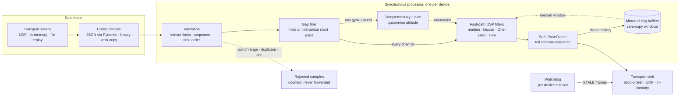

# BioKineX

**Deterministic, real-time DSP middleware for stabilizing high-frequency kinematic telemetry.**

[](https://github.com/busradeveci/biokinex)
[](https://www.python.org/)
[](LICENSE)
[](https://mypy.readthedocs.io/)
[](#development)

---

## Executive summary

BioKineX is a rigorous, real-time signal-processing layer that sits between high-frequency motion
sensors and the controllers that act on them. It accepts raw telemetry from IMUs, wearables,
robotic joints, and prosthetic devices at 500 Hz and above, and turns it into clean, validated
pose frames with an explicit health status.

- **Rigorous input handling.** Every packet is checked against its schema, physical sensor
  limits, sequence order, and time order. Implausible samples are rejected and counted, never
  forwarded.
- **Gimbal-lock-free orientation.** Orientation is fused, filtered, and stored as unit
  quaternions from end to end. Euler angles are derived only at the output, with an explicit
  flag near ±90° pitch.
- **Bounded memory.** All history lives in preallocated, mirrored ring buffers and bounded
  queues. Memory growth stays below 5 KiB over 25,000 streamed samples.
- **Fail-safe output.** Every outgoing frame passes full Pydantic validation, so a NaN or a broken
  quaternion can never reach an actuator. A watchdog emits `STALE` frames when a device goes
  silent.
- **Deterministic and inspectable.** Pure closed-form DSP with no machine learning. Identical input
  always yields identical output, so recorded sessions replay exactly.

## Why BioKineX?

Wearable IMU arrays, biomechanical interfaces, and robotic prosthetics produce telemetry at hundreds
of samples per second. That raw signal is never clean:

- **Sensor noise and mechanical vibration** superimpose high-frequency jitter on every axis.
- **Gyroscope drift** slowly corrupts integrated orientation.
- **Physiological tremor** adds a 4–12 Hz oscillation that a controller should not reproduce.
- **Packet drops, duplicates, and reordering** break the assumption of a uniform sample stream.
- **Out-of-range or non-finite values** (saturation, glitches, corrupted frames) appear without warning.

Feeding that stream directly into an actuator or controller produces mechanical jitter, instability,
and genuine safety hazards. BioKineX ingests the noisy telemetry, rejects what is physically
implausible, fuses and filters what remains, and dispatches stabilized pose frames in real time.

## Design principles

| Principle | What it means in practice |
|---|---|
| **Deterministic** | Pure algorithmic DSP. Filters run on sensor timestamps, never the wall clock, so recorded sessions replay exactly. |
| **Bounded memory** | Fixed-capacity, preallocated ring buffers and drop-oldest queues. No unbounded growth over hours of streaming. |
| **Fail-safe** | Invalid samples are rejected and counted, not propagated. Filled gaps are marked `DEGRADED`, silence produces `STALE` frames, and an optional slew-rate limiter caps output dynamics. |
| **Sync core, async shell** | All validation and DSP live in a synchronous, side-effect-free processor. `asyncio` is used only at the I/O edges. |
| **Strictly typed** | Full type hints, checked under `mypy --strict`, shipped with `py.typed`. |
| **Minimal footprint** | Runtime dependencies are NumPy and Pydantic, nothing else. |

### Scope and non-goals

- **No machine learning.** BioKineX contains no model training, learned weights, or neural-network
  inference. Every transformation is a closed-form, inspectable algorithm.
- **No personal data.** The system handles physical kinematics only: acceleration, angular rate,
  orientation, and joint angles. Sources are identified by opaque device and joint identifiers;
  there are no fields for personal or health information.

## Architecture



1. **Transport source**: receives raw packets over UDP, an in-process queue, or file replay.
2. **Codec decode**: JSON packets are parsed by Pydantic v2 directly from bytes; binary packets
   are read zero-copy with a structured NumPy dtype. Structure, types, and finite values are
   enforced at this trust boundary.
3. **Validation**: vectorized checks enforce physical sensor limits and time order, and detect
   sequence gaps, duplicates, reordering, and device restarts. Clean in-order batches take an
   array-only fast path.
4. **Gap filler**: short gaps are held or interpolated (slerp for orientation) so filters see a
   steady rate. Frames that depend on filled samples are marked `DEGRADED`; long gaps restart the
   filters instead.
5. **Fusion and DSP filters**: a Mahony-style complementary filter estimates attitude from the raw
   gyroscope and accelerometer. Each channel then runs through its configured chain: median spike
   rejection, Butterworth low-pass and notch biquads, One-Euro smoothing, and slew limiting.
6. **Mirrored ring buffers**: preallocated circular buffers that expose any recent window as one
   contiguous, zero-copy NumPy view. They back the median filter and the per-device frame history.
7. **Safe PoseFrame**: every output frame is fully validated and carries orientation, angular
   velocity, acceleration, joint angles, derived Euler angles, and an `OK` / `DEGRADED` / `STALE`
   status.
8. **Transport sink**: frames are sent through a bounded queue with a drop-oldest policy, because
   for real-time control a fresh frame is worth more than a complete history.

### Orientation conventions

Orientation is represented as **unit quaternions** throughout the pipeline. This avoids gimbal lock
and the ±180° discontinuities that make naive filtering of Euler angles unsafe.

| Convention | Choice |
|---|---|
| Quaternion algebra | Hamilton |
| Component order | `(w, x, y, z)`, scalar first |
| Sign ambiguity | Hemisphere-consistent: each output quaternion stays in the same hemisphere as its predecessor |
| Euler angles | Intrinsic **ZYX** (yaw → pitch → roll), reported as `(roll, pitch, yaw)` and derived only at the output |
| Orientation filtering | Performed on rotation increments in the tangent space, so outputs remain unit quaternions |

Each frame's `near_gimbal_lock` flag is set when pitch approaches ±90°, where roll and yaw become
unreliable.

### Units

All internal computation uses SI units: seconds, m/s², rad/s, and radians. JSON packets may declare
other units (`g`, `deg/s`, or `deg`); they are converted once at decode time.

## Installation

BioKineX requires **Python 3.11 or newer**.

```bash
pip install git+https://github.com/busradeveci/biokinex.git
```

For development, clone the repository and install it in editable mode:

```bash
git clone https://github.com/busradeveci/biokinex.git
cd biokinex
python -m venv .venv
source .venv/bin/activate          # Windows (PowerShell): .venv\Scripts\Activate.ps1
pip install -r requirements-dev.txt
pip install -e .
```

## Quick start

```python
from biokinex.pipeline import PipelineProcessor
from biokinex.schemas import PipelineConfig
from biokinex.transport import JsonCodec

config = PipelineConfig.from_toml_file("biokinex.toml")
processor = PipelineProcessor(config)  # One processor per device.
codec = JsonCodec()

for payload in incoming_packets():  # Your source of raw bytes.
    result = processor.process(codec.decode_packet(payload))
    for frame in result.frames:
        # frame.status is OK, or DEGRADED when the frame depends on filled-in samples.
        controller.update(frame.orientation, frame.angular_velocity, frame.status)
```

For a complete async deployment, `PipelineRuntime` connects any source and sink, manages one
processor and one watchdog per device, and reports latency statistics:

```python
from biokinex.pipeline import PipelineRuntime
from biokinex.transport import BinaryCodec, UdpSink, UdpSource

source = await UdpSource.open("0.0.0.0", 9000)  # Devices send packets here.
sink = await UdpSink.open("10.0.0.5", 9001)  # The controller receives frames here.
runtime = PipelineRuntime(config, source, sink, codec=BinaryCodec())
stats = await runtime.run()  # Runs until runtime.stop() is called.
```

### Configuration

Pipelines are configured in TOML and validated by Pydantic before any processing starts:

```toml
sample_rate_hz = 500.0
watchdog_timeout_s = 0.05

[[acceleration_filters]]
kind = "median"
window = 3

[[acceleration_filters]]
kind = "low_pass"
cutoff_hz = 25.0

[[angular_velocity_filters]]
kind = "one_euro"
beta = 0.05

[[orientation_filters]]
kind = "slew_rate"
max_rate = 8.0

[fusion]
enabled = true
gain = 1.0

[gap]
policy = "linear"
max_fill_samples = 10
```

Filter frequencies are checked against the Nyquist limit, and sensor limits (`[limits]`) and
sequence tracking (`[sequence]`) have safe defaults.

### Wire format

A JSON telemetry packet carries one or more consecutive samples from one device:

```json
{
  "device_id": "wrist-imu-01",
  "units": {"acceleration": "m/s^2", "angular_velocity": "rad/s", "angle": "rad"},
  "samples": [
    {"sequence": 0, "timestamp": 0.000, "acceleration": [0.0, 0.0, 9.81], "angular_velocity": [0.0, 0.0, 0.5]},
    {"sequence": 1, "timestamp": 0.002, "acceleration": [0.0, 0.0, 9.80], "angular_velocity": [0.0, 0.0, 0.5]}
  ]
}
```

For the lowest overhead, `BinaryCodec` uses a compact little-endian format that is decoded
without copying sample data, and encodes a frame in about 5 µs.

### Examples

The [`examples/`](examples) folder contains two runnable scripts:

| Script | What it shows |
|---|---|
| [`process_packets.py`](examples/process_packets.py) | The synchronous processor: TOML config, JSON packets, a lost packet filled as `DEGRADED`, a gyroscope glitch rejected, and frames read as Euler angles and JSON. |
| [`udp_runtime.py`](examples/udp_runtime.py) | The async runtime between two UDP sockets with the binary codec, the watchdog sending `STALE` frames when the device goes silent, and latency statistics. |

```bash
python examples/process_packets.py
python examples/udp_runtime.py
```

## Package layout

```
src/biokinex/
├── core/            # types, quaternion math, injectable clock, errors
├── schemas/         # Pydantic models: telemetry packets, pose frames, sensor limits, pipeline config
├── validation/      # semantic validator, sequence tracking
├── buffers/         # mirrored zero-copy ring buffer
├── dsp/             # One-Euro, complementary (Mahony-style), biquad, median, slew, gap, rotation
├── pipeline/        # filter factory, frame history, synchronous processor, async runtime, watchdog
├── transport/       # source/sink protocols, JSON & binary codecs, UDP, memory, replay
└── observability/   # latency histograms
```

## Performance

At 500 Hz each sample has a 2 ms budget. Measured on a Windows 11 laptop with Python 3.14, one
sample per packet unless noted. The full configuration uses median + low-pass on acceleration,
notch + One-Euro on angular velocity, complementary fusion, and One-Euro + slew on orientation.

| Benchmark | Mean | p99 |
|---|---|---|
| `OneEuroFilter`, 3-vector step | 10 µs | 19 µs |
| `OrientationOneEuroFilter` step | 7 µs | 11 µs |
| Binary packet decode | 17 µs | 24 µs |
| JSON packet decode | 22 µs | 48 µs |
| Frame encode, binary / JSON | 5 / 54 µs | 9 / 87 µs |
| Gap filler, no gap / one missing sample | 10 / 67 µs | 18 / 123 µs |
| Processor, full configuration | 129 µs | 242 µs |
| Runtime, binary bytes in to frame bytes out | 170 µs | 273 µs |

The full pipeline uses about 7% of the per-sample budget on average and about 12% at p99. Every
frame keeps its full output validation; BioKineX does not trade safety checks for speed. Memory
growth over 25,000 streamed samples is below 5 KiB.

## Development

```bash
pytest                                  # run the test suite
pytest --cov                            # with branch coverage
pytest -m integration                   # end-to-end tests over real UDP sockets, replay, and examples
pytest tests/benchmarks --benchmark-enable --no-cov   # latency benchmarks (timing is off by default)
mypy                                    # strict static type checking
ruff check .                            # lint
ruff format .                           # format
```

The test suite has 100% branch coverage. It combines known-answer tests for filter mathematics
(step response, cutoff frequency, steady-state error), property-based tests via Hypothesis
(outputs are always finite, unit quaternions stay normalized, slew limits are never exceeded, the
full pipeline is deterministic), integration tests over real transports, memory-growth checks,
and benchmark guards against latency regressions.

## Contributing

Contributions are welcome. Please ensure that `pytest`, `mypy`, and `ruff check` all pass, and that
new behaviour is covered by tests. Changes must respect the project's scope: deterministic
algorithmic signal processing only, and no personal data.

## License

BioKineX is licensed under the [Apache License 2.0](LICENSE).
